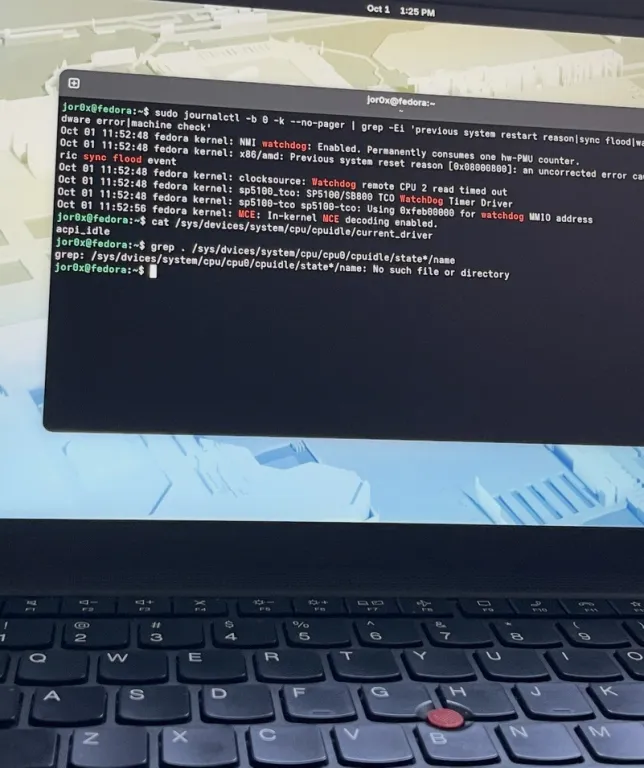
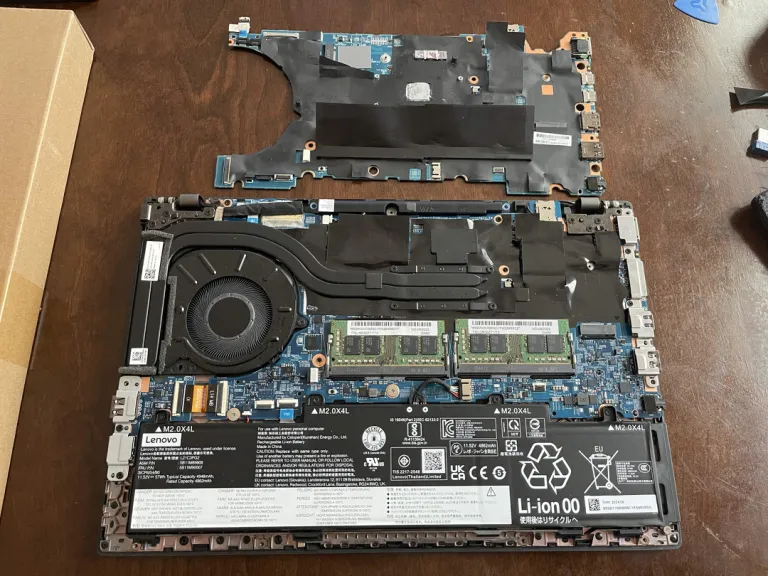
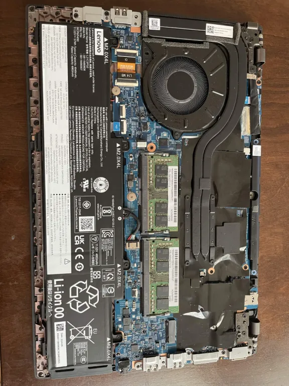
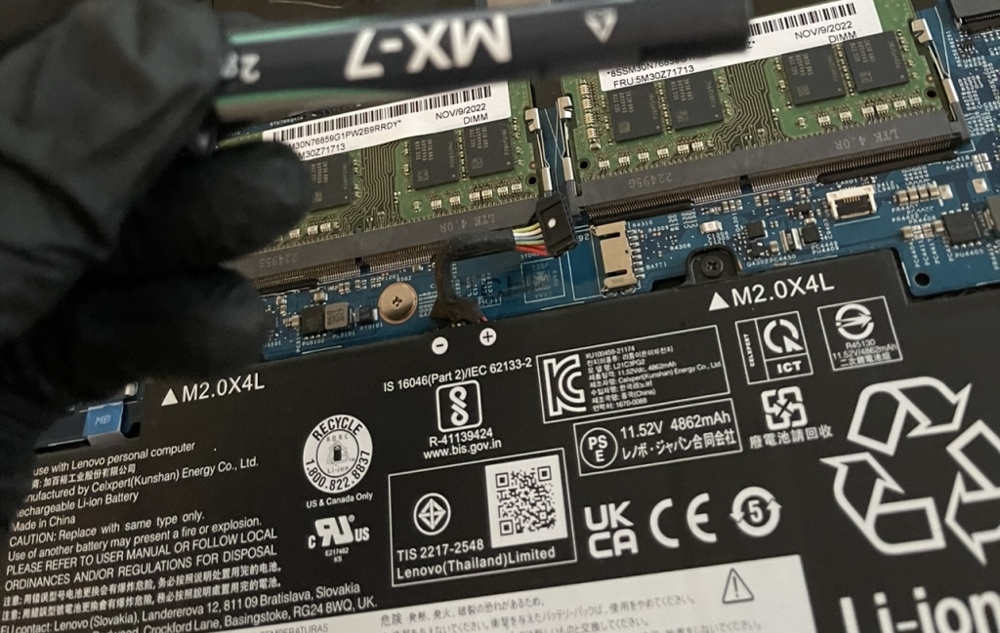
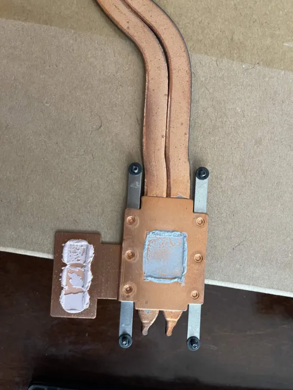
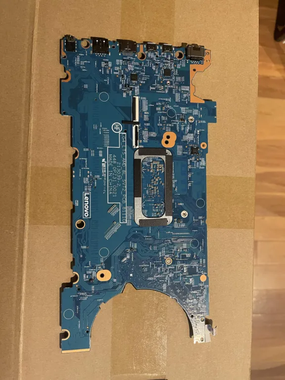
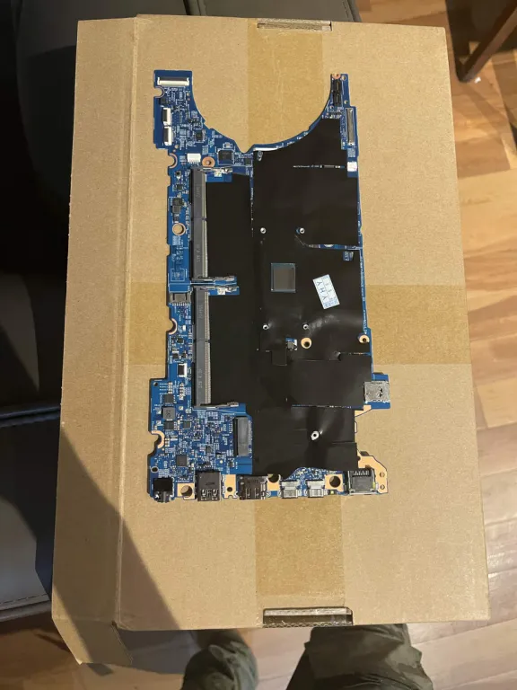

# ThinkPad crash investigation and motherboard replacement

I worked on my Lenovo ThinkPad L14 Gen 3 AMD after it began black-screening, restarting, or shutting down during normal use. The failures appeared in both Windows and Linux. I compared system logs, ran the diagnostics available to me, tested fresh and live operating systems, and then replaced the system board. The laptop ran for several weeks without the recurring crashes afterward.

## The laptop and repair

The original system was reported as a ThinkPad L14 Gen 3 AMD, type 21C6, with a Ryzen 5 PRO 5675U processor. I replaced its system board with a compatible board listed as Lenovo FRU 5B21H55116 and Ryzen 7 PRO 5875U. The listed processor has 8 cores and 16 threads, compared with 6 cores and 12 threads in the original configuration. The CPU is soldered to this board, so the replacement also changed board-level power and interconnect components. This was a broad repair, not a component-level diagnosis.

## Errors and clues I investigated

- Windows Kernel-Power 41 recorded unexpected shutdowns. It identifies the reset event, not its cause.
- Windows WER/BugCheck 1001 and WHEA-Logger 18, 19, 20, and 46 events appeared during testing. I would need the full event payloads to classify each one precisely.
- Linux reported AMD reset reason `[0x08000800]`: “an uncorrected error caused a data fabric sync flood event.” I also saw clocksource watchdog timeouts, including `Watchdog remote CPU 4 read timed out`.
- Btrfs tree-log replay showed up after sudden shutdowns. I treated that as a possible effect of interrupted shutdowns, not proof the SSD caused the original issue.

These messages helped me prioritize a platform or board-level problem. None of them identified a specific failed chip.

## What I tried before replacing the board

I tried Windows recovery and Safe Mode paths, reviewed firmware settings, ran Lenovo diagnostics, checked the NVMe and battery health, and tested Ubuntu live media and Fedora live or installed environments. The crashes continued outside the original Windows installation and after the SSD had been securely wiped. Some diagnostics passed, which lowered suspicion of an obvious fault but could not rule out an intermittent one.

Power-management changes did not provide a lasting fix. Disabling `amd_pstate` did not stop the crashes. Limiting processor C-states gave me a session longer than eight hours, but a reset later happened again. Offline tests with Wi-Fi disabled also ended in crashes, so I could not isolate the Wi-Fi card as the cause. One UEFI battery test appeared stuck around 31 percent without a confirmed final result, so I counted it as inconclusive.

## Repair challenges

During the swap, I dealt with a difficult battery screw, protective sheets and cable routing, and small ribbon-cable latches. I transferred the Wi-Fi card and reconnected its MAIN and AUX antenna leads. I cleaned the old thermal compound from the heatsink and processor contact surfaces with alcohol wipes, applied fresh compound, and reinstalled the heatsink. I checked the fan connection and exhaust path during reassembly. An unpopulated connector for an optional smart-card reader did not by itself indicate a missing required part.

## Outcome

By November 25, 2026, I had several weeks of normal use without the recurring crashes. The repair strongly supports a fault involving the original motherboard assembly or a connection affected during replacement. I did not identify the exact failed component, and changing the whole board also changed several things at once.

This is my personal repair record, reconstructed from troubleshooting notes, screenshots, and my observations. It is not a manufacturer forensic diagnosis. The accompanying detailed case report has the test results and limitations.

## Photos from the repair

The photos show the Linux log excerpt, the laptop opened during the board swap, hands-on details, thermal compound, and views of the system board.

*October 1 Linux log excerpt. I left the exploratory commands in the photo so it reflects the actual troubleshooting session.*

*Two system boards are visible: one loose beside the open laptop and one still in the chassis during the swap.*

*Full internal view of the laptop during the repair.*

*My gloved hand beside the battery and memory area during disassembly.*

*I took this photo before removing the old thermal compound. I cleaned the contact surfaces with alcohol wipes, applied fresh compound, and reinstalled the heatsink during reassembly.*

*A close view of the board’s component side.*

*A view of the board with its protective shielding in place.*
